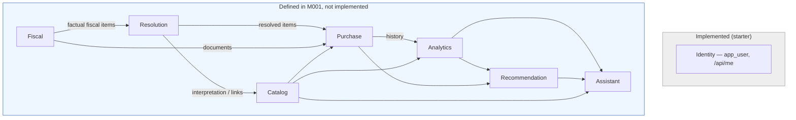

# Carrinho Esperto — Architecture (M001)

> **This document is conceptual.** M001 creates no migration, endpoint, screen,
> domain class or behaviour. Its purpose is to fix the domain architecture —
> bounded contexts, ownership boundaries and architectural rules — so that every
> later milestone is built against a model that was discussed and justified, not
> discovered in code. Functionality named here as "future" is **deferred on
> purpose** (see §10).

---

## 1. What Carrinho Esperto is

Carrinho Esperto is a Brazilian supermarket **purchase intelligence**
application. It starts from a fiscal receipt (NFC-e) and, over successive
milestones, turns a stream of receipts into a structured understanding of what a
household buys, from whom, how often and at what price — and then uses that
understanding to help the user spend better.

It is **not**, at its core, a QR-code reader. QR-code retrieval is only the
ingestion edge. The durable value of the system is the **canonical product
catalog and the accumulated resolution knowledge** that maps messy, store-specific
fiscal text onto that catalog.

## 2. Product vision

The full user journey the product is being built toward:

```text
NFC-e QR Code
    ↓
Fiscal document retrieval
    ↓
Fiscal document persistence
    ↓
Product identification
    ↓
Canonical product resolution
    ↓
Purchase history
    ↓
Spending and price analytics
    ↓
Shopping intelligence
```

Only the *shape* of this pipeline is being fixed now. No stage of it is
implemented in M001.

## 3. Where this sits relative to the starter

The repository was generated by **saas-init-java** and currently contains one
vertical slice: `GET /api/me` (JWT → Spring Security → provisioning filter →
`UserService` → ELSQL `UserRepository` → Postgres). See the root `README.md`.

The architectural conventions below are **inherited from that starter and from
the RegulationAI project** used as a reference. Carrinho Esperto does not
introduce a new architectural style; it adds bounded contexts on top of the
existing one.

| Concern | Convention (unchanged) |
|---|---|
| Language / framework | Java 25, Spring Boot 4.1.x |
| Package root | `br.com.carrinhoesperto` |
| Layering | `model` (records) → `repository` → `service` → `controller` + `dto`; no repository interfaces, no ORM |
| Persistence | Spring JDBC + **ELSQL** (`sql/*.sql`, loaded via `ElSqlConfiguration`), PostgreSQL 17 |
| Schema | **Flyway** forward-only migrations, `db/migration/V{n}__<name>.sql` |
| Identity | Cognito JWT; the subject is read only from `AuthenticatedUser`, never from a request field. Ownership is always the authenticated principal |
| Errors | `@RestControllerAdvice` → RFC 9457 `ProblemDetail`; one handler per domain exception |
| Tests | JUnit 5 + Testcontainers; `AbstractIntegrationTest` / `AbstractAuthenticatedIntegrationTest` reuse a running `docker compose` or start their own |
| Frontend | React 19 + Vite + TypeScript + Tailwind v4; Cognito login in the browser, bearer token to the API |
| Local infra | `docker compose up` → Postgres + MiniStack (Cognito) + one-shot `bootstrap` |

New backend code for a bounded context lives under
`br.com.carrinhoesperto.<context>` (e.g. `br.com.carrinhoesperto.fiscal`).
Whether contexts are split into Maven modules is a later decision; the package
boundary is the contract that matters now.

## 4. Architectural principles

These are project rules, not aspirations.

### 4.1 Fiscal truth must be preserved

Fiscal information is *what the fiscal document actually says*. It is stored
verbatim and never silently rewritten by any interpretation Carrinho Esperto
makes.

```text
raw_description = "LEITE ITALAC INT 1L"      ← fiscal truth, stored as-is
"Italac Leite UHT Integral 1L"               ← canonical interpretation, lives in Catalog/Resolution
```

The second string is a *conclusion*. It must never overwrite the first.

### 4.2 Catalog data is interpretation

The Catalog is Carrinho Esperto's **canonical understanding** of a product
(manufacturer, brand, category, subcategory, family, variant, flavour, package,
unit, size, …). It evolves on its own timeline, independent of any particular
receipt, and may be corrected or enriched after the fact without touching fiscal
records.

### 4.3 Resolution can be uncertain

A fiscal item does **not** have to be fully identified before its purchase can be
stored. Resolution is allowed to be incomplete or provisional. The conceptual
states are:

```text
RESOLVED     — confidently mapped to one canonical product
PROBABLE     — one strong candidate, not confirmed
AMBIGUOUS    — several plausible candidates
UNRESOLVED   — no usable candidate yet
```

The resolution engine is **not** built in M001. The architecture only commits to
the fact that canonicalization is an evidence-based process that improves over
time.

### 4.4 Resolution must preserve evidence

A resolution is never reducible to *"the AI guessed the product."* Every
resolution should eventually be able to explain **why** it reached its
conclusion, from named evidence. See [resolution-model.md](resolution-model.md)
for the evidence catalog and the conceptual `ProductResolution` /
`ResolutionEvidence` shapes.

### 4.5 Store-specific knowledge is first-class

Different supermarkets use different descriptions, abbreviations, product codes
and units for the same product:

```text
LEITE ITALAC INT 1L
ITALAC LEITE UHT 1LT
LT ITALAC INTEGRAL 1000ML
```

The store/merchant context is therefore a **first-class input** to future
resolution — not an afterthought. Store vocabulary (codes, aliases, unit and
brand normalisations) is a planned capability, described in
[resolution-model.md](resolution-model.md). It is not implemented in M001.

### 4.6 External product databases are providers, not owners

GS1 / GTIN registries, Open Food Facts, commercial catalogs and supermarket
websites are **providers of evidence and candidate data**. They never become the
canonical database. Carrinho Esperto always keeps its own catalog and decides
what to accept from a provider.

### 4.7 AI is an implementation capability, not the domain

AI is not introduced into core domain entities. The domain vocabulary is
`ProductCandidate`, `Resolution`, `Evidence`, `Confidence`, `Recommendation` —
never a provider- or model-specific concept. When AI is eventually used, it is
one evidence source / provider behind those domain concepts.

## 5. Bounded contexts



### Fiscal

Owns the fiscal document and everything the document itself reports.

```text
FiscalDocument     — the NFC-e as retrieved (access key, issue date, totals, raw payload)
FiscalItem         — a line as printed: rawDescription, quantity, unit, unitPrice, lineTotal, storeProductCode
Payment            — tender lines as reported
Merchant / Issuer  — the establishment as identified on the document (CNPJ, name, address)
```

Fiscal **must not** own canonical product interpretation. `FiscalItem.rawDescription`
is source truth; it is not a product name.

### Catalog

Owns Carrinho Esperto's canonical product knowledge. Expected future concepts:

```text
Manufacturer  Brand  Category  Subcategory  ProductFamily
Product  Variant  Flavor  Unit  PackagingType  Attribute  Alias
```

The full catalog is **not** built in M001.

### Resolution

Owns the mapping between a `FiscalItem` and a canonical `Product`.

```text
FiscalItem  →  Resolution  →  CanonicalProduct
```

Resolution carries status, confidence, method and evidence. It consumes Fiscal
(read-only) and Catalog (read-only), and produces links + resolution records. It
never mutates fiscal rows. Detail: [resolution-model.md](resolution-model.md).

### Purchase

Owns the user's purchase history — the relationship between fiscal documents and
a given user's basket over time. Not implemented in M001.

### Analytics

Owns **derived** information: spending, price history, category/brand analysis,
basket analysis, purchase frequency, trends. Analytics **consumes** domain data;
it is never the source of fiscal or catalog truth. Not implemented in M001.

### Recommendation

Future context: substitutions, savings opportunities, shopping-list
intelligence. Not implemented in M001.

### Assistant

Future context: a natural-language interface over the user's data and the
available intelligence. Not implemented in M001.

## 6. Domain separation — the core distinction

```text
Fiscal
   │  factual fiscal information
   ▼
Resolution
   │  interpretation
   ▼
Catalog
   │  canonical product knowledge
   ▼
Purchase / Analytics
```

The single most important rule in the whole architecture:

```text
FiscalItem.rawDescription   ≠   Product.name
```

The first is **source truth** — immutable, per document, per store.
The second is **canonical interpretation** — mutable, shared, improved over time.
They are never the same column and never live in the same context.

## 7. Data ownership rules

Each concept has exactly one owning context. No shared ownership.

| Concept | Owning context |
|---|---|
| `FiscalDocument` | Fiscal |
| `FiscalItem` (incl. `rawDescription`, `storeProductCode`, quantities, prices) | Fiscal |
| `Payment` | Fiscal |
| `Merchant` / `Issuer` (as reported on the document) | Fiscal |
| `Product`, `Product.name`, `Product.brand`, `Product.manufacturer` | Catalog |
| `Manufacturer`, `Brand`, `Category`, `Unit`, `PackagingType`, `Attribute`, `Alias` | Catalog |
| Store vocabulary (`StoreProductCode` mapping, `StoreProductAlias`, `StoreBrandAlias`, `StoreUnitAlias`, …) | Resolution (store-scoped knowledge) |
| `ProductResolution`, `ResolutionEvidence`, `ProductCandidate` | Resolution |
| `Purchase`, purchase history, basket-over-time | Purchase |
| Spending / price / category / trend metrics | Analytics |
| Recommendations, substitutions, savings | Recommendation |
| `User` / identity (`app_user`) | Identity (existing) |

When a downstream context needs an upstream concept, it **references it by id**
and reads it — it does not copy or re-own it.

**Ownership scope differs by context.** Fiscal data is **user-owned**: a
`FiscalDocument` has an `owner_user_id` and a cross-user read is a 404. Catalog
data is **platform-owned and shared**: a `Product` (and `Manufacturer`,
`Brand`, `Category`, `Subcategory`, `ProductFamily`) has *no* user/owner column
— one canonical `"Leite UHT Integral Jussara 1L"` is seen by every user. See
[catalog-model.md](catalog-model.md).

> Fiscal owns observed fiscal truth. Catalog owns canonical product identity.
> Resolution connects the two.

### M006.1 — anonymous trial & basket insight

**Anonymous trial ownership.** The first experience must not require a Cognito
account (see [anonymous-trial.md](anonymous-trial.md)). An anonymous trial
session is an `app_user` row with `kind = 'ANONYMOUS'` and no `cognito_subject`,
identified by a hashed opaque token the browser sends as `X-Anon-Session`.
Because it is a real `app_user` row, **every owner-scoped rule above is
unchanged** — Fiscal / Dashboard / Resolution / Insight all key on
`owner_user_id` / `app_user.id`, so an anonymous session sees only its own data,
a cross-session read is a 404, and authenticated ownership is untouched.
`/api/admin/**` stays `ROLE_ADMIN`-only; a trial caller holds only `ROLE_TRIAL`.
Trial data is session-oriented, not persistent user data: `last_seen_at` is
recorded for a future retention sweep; M006.1 builds no cleanup job and no
account conversion.

**`insight`** (basket categorization + health seal, see
[basket-insight.md](basket-insight.md)) is a thin read/derive layer like
`dashboard` — **not** a bounded context. It groups a receipt's items into coarse
categories from their `raw_description` with a deterministic keyword ruleset (no
catalog, no NCM, no AI) and returns aggregates. It never persists anything, never
touches Resolution or Catalog, and never rewrites fiscal truth.

## 8. Future resolution model (summary)

The intended conceptual priority order (not a fixed algorithm, not a scoring
system, no hard-coded weights in M001):

```text
1. Fiscal identifiers (GTIN/EAN on the item)
2. Store-specific product codes
3. Store-specific aliases
4. Global aliases
5. Catalog matching (attributes, brand, package, unit)
6. External product providers (GS1, Open Food Facts, store sites) — as evidence
7. Evidence-based candidate ranking
8. AI-assisted resolution — as one more evidence source
9. User confirmation — the strongest signal
```

Full treatment, including the evidence catalog and the conceptual
`ProductResolution` / `ResolutionEvidence` records: [resolution-model.md](resolution-model.md).

## 9. Onboarding checklist

A developer joining the project should read, in order: this document, then
[resolution-model.md](resolution-model.md), then the root `README.md` for how to
run the starter. After that they should be able to state:

1. What Carrinho Esperto is and its product vision (§1, §2).
2. The seven bounded contexts and each one's responsibility (§5).
3. Why `FiscalItem.rawDescription` is not `Product.name` (§4.1, §6).
4. That resolution is allowed to be uncertain, and the four states (§4.3).
5. That resolution is evidence-based and must be explainable (§4.4, resolution-model.md).
6. That store vocabulary is a first-class future input (§4.5).
7. That external catalogs are providers, never the canonical source (§4.6).
8. That AI is an implementation capability behind domain concepts (§4.7).
9. Which functionality is deferred (§10).

## 10. Explicitly deferred (not in M001, and roadmap)

M001 implements **none** of the following. Each is a later milestone.
**Status:** M002 delivered *Fiscal document persistence*
([fiscal-core.md](fiscal-core.md)); M003 delivered *São Paulo NFC-e QR
ingestion* ([nfce-ingestion.md](nfce-ingestion.md)); M004 delivered the
*Catalog foundation* ([catalog-model.md](catalog-model.md)); M005 delivered the
*Resolution context* with deterministic exact-GTIN resolution
([resolution-core.md](resolution-core.md)); M006 delivered the first usable
*consumer frontend + admin* and its read/aggregation endpoints
([frontend.md](frontend.md)).

The active data flow is now:

```text
Fiscal (user-owned)  ──►  Resolution (platform-owned)  ──►  Catalog (platform-owned, shared)
 FiscalItem.cEAN/cEANTrib   ProductResolution + evidence      Product.gtin
```

Resolution references Fiscal and Catalog by id; neither references Resolution.

| Capability | Context | Notes |
|---|---|---|
| ~~NFC-e QR-code URL ingestion~~ | Fiscal (ingestion) | **done in M003 for São Paulo** — QR URL → SEFAZ-SP consultation → parsed document. Other states pending |
| NFC-e QR-code retrieval from an image | Fiscal (ingestion) | decoding the QR from a photo — later |
| ~~NFC-e website retrieval~~ | Fiscal (ingestion) | **done in M003 (SP)** — allow-listed SEFAZ-SP fetch |
| ~~NFC-e parsing~~ | Fiscal | **done in M003 (SP)** — HTML consultation → `FiscalDocumentRequest` |
| ~~Fiscal document persistence~~ | Fiscal | **done in M002** — tables + ELSQL + repository/service/API |
| ~~Product catalog tables~~ | Catalog | **done in M004** — `manufacturer` / `brand` / `category` / `subcategory` / `product_family` / `product`, platform-owned; canonical GTIN; deterministic lookup/search |
| Richer product attributes (flavor, fat content, zero-sugar, …) | Catalog | modelled from real data later — no speculative EAV framework |
| ~~Deterministic GTIN resolution~~ | Resolution | **done in M005** — `product_resolution` / `resolution_evidence`, `GTIN_EXACT`, `RESOLVED`/`UNRESOLVED` |
| ~~Store product code resolution~~ | Resolution | **done in M007** — `store_product_code` `(issuer CNPJ, cProd) → product`, `STORE_PRODUCT_CODE` method (order 20, GTIN wins), admin-curated, platform-owned; strategy pipeline; `docs/store-vocabulary.md` |
| Store aliases / unit & brand normalisation | Resolution | deferred past M007 — `(store, cProd)` only for now |
| Evidence-based resolution engine | Resolution | description/fuzzy/ranking, `PROBABLE`/`AMBIGUOUS`, confidence — later |
| External provider integrations | Resolution / providers | GS1, Open Food Facts, store sites — as evidence |
| AI integration | providers | one evidence source behind `Evidence`/`Confidence` |
| Spending analytics | Analytics | |
| Price analytics / price history | Analytics | |
| Shopping recommendations | Recommendation | |
| Assistant (NL interface) | Assistant | |
| Subscriptions / monetization | — | out of domain scope for now |
| Household management | — | out of domain scope for now |

## 11. Open questions / ambiguities

- **Module vs package boundary.** M001 fixes contexts as packages under
  `br.com.carrinhoesperto`. Whether Fiscal/Catalog/Resolution become separate
  Maven modules (or even services) is deferred until the first two are built and
  the coupling is real.
- **Where store vocabulary physically lives.** It is store-scoped interpretation,
  so this document assigns it to Resolution. An argument exists for a dedicated
  `Store` context later; revisit when store vocabulary is actually implemented.
- **Merchant identity reconciliation.** Fiscal owns the merchant *as reported*.
  A canonical "this is the same store across receipts" concept may be needed by
  Analytics/Resolution later; not decided in M001.
- **GTIN on the fiscal item.** NFC-e items often carry an EAN/GTIN. It is fiscal
  truth (owned by Fiscal) *and* the highest-priority resolution identifier
  (consumed by Resolution). This is a read dependency, not shared ownership.
